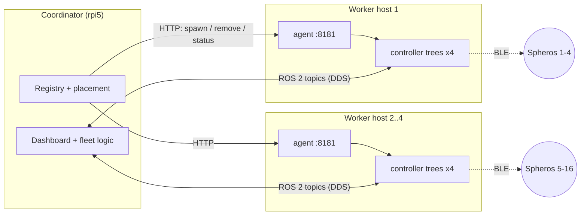

# Your robot is too small for its own brain: hosting controllers off-board

*Draft — Siddharth Vaghela*

A Sphero BOLT is a sealed plastic ball with motors, an IMU, an LED matrix and a
Bluetooth Low Energy radio. It has no Linux, no ROS 2, and nowhere to put either.
Everything that makes it a *robot* in my lab — the device driver, the task
executor, the state machine, the ROS 2 topics — runs somewhere else and talks to
the ball over BLE.

That is not unusual. A lot of edge robots are like this: BLE toys, microcontroller
rovers behind a micro-ROS agent, nano-drones behind a radio dongle. The robot is a
peripheral; its controller lives on a host.

With one robot, "a host" is your laptop and you never think about it. This post is
about what happened when I went to sixteen, why the answer turned out to be a
small general pattern rather than a Sphero-specific hack, and the library I
extracted from it: **[roost](https://github.com/artineering/roost)**.

## The wall: sixteen robots, one radio

My fleet is sixteen Spheros doing multi-robot coordination experiments, with
positions coming from an external localization system. Each Sphero has a controller
*tree* of four processes: a small web/WebSocket server that owns the robot's
control panel, plus three ROS 2 nodes it launches — a device controller (the only
one that touches BLE), a task controller, and a state-machine controller.

Originally a single Raspberry Pi 5 ran everything: the web dashboard, the
positioning pipeline, the fleet node, and every Sphero tree. The Pi had CPU to
spare. What it did not have was radio. One Bluetooth adapter holds a handful of
concurrent BLE connections reliably; on my hardware the number I could validate
was about four. Past that, connections dropped and commands lagged, no matter how
idle the CPU was.

So the scarce resource was not compute. It was **BLE links per radio**, and the
only way to get more of it was more radios, which means more hosts: four
Raspberry Pi 4 workers, four Spheros each, with the Pi 5 staying on as the
coordinator.



That moved the problem. Before, "add a Sphero" was a `subprocess.Popen` and a
handle I could `poll()` and `terminate()`. Now the process had to start on a
different machine, and three things I had taken for granted — starting it,
stopping it, and knowing whether it was alive — all assumed a local process
handle.

## Three ways to start a process on another machine

**SSH.** `ssh pi@worker ros2 run ...` from the coordinator. Nothing to install,
and it works in a demo. But the process's lifetime is tied to an SSH channel,
"is it alive?" becomes "is the SSH client alive?", which says nothing about a
crashed grandchild, and tearing down a four-process tree through a remote shell is
exactly as fiddly as it sounds. It also needs passwordless keys from the
coordinator to every worker.

**ROS 2-native.** Lifecycle nodes, a launch service, composable containers. This
is the "correct" answer on paper and a large rewrite in practice. It also would
not have covered the piece of each tree that is not a ROS node at all.

**A small agent on each host.** A tiny HTTP service that runs on every worker and
knows how to do three things locally: start a controller tree, stop it, and report
what is running. The coordinator's add/remove/list become HTTP calls.

I picked the agent, and the reason is the one idea in this post I would defend
hardest: **process management is easy on the machine where the processes are and
miserable from anywhere else.** A local parent has a real process handle, can put
the tree in its own process group, can signal the whole group, can see an exit
code, and can own the log file. Every remote approach is an attempt to tunnel
those abilities through something. The agent just puts a parent where the
children are and gives it a narrow API.

## What the agent has to get right

The first version was about 350 lines of Python. Most of the lines that matter
came from things going wrong.

**Kill the tree, not the process.** The root of each tree launches three children.
If the device controller survives its parent as an orphan it still holds the BLE
connection — so the robot looks free, but the next controller that tries to
connect to it cannot. Each unit therefore starts in its own session and process
group, and teardown signals the group: `SIGTERM`, wait out a grace period, then
`SIGKILL` whatever is left. For a BLE robot, "the link is released when I say
remove" is the whole point of teardown.

There is an honest limit here. A group signal only reaches processes that stayed
in the group. My Sphero launcher puts its three controllers in process groups of
their own and stops them in its `SIGTERM` handler, so they go away because the
root shuts down *cleanly*, not because the agent can reach them. That is why the
grace period before `SIGKILL` is a per-unit-type setting and not a constant: it is
how long you are willing to wait for a clean release before accepting a messy
one.

**Shut down like you mean it.** When systemd stops the agent, every tree on that
host has to go too. The agent's HTTP server runs in a background thread while the
main thread does nothing but wait for a signal, so that `SIGTERM` reliably runs
the teardown instead of getting lost in a blocking server loop.

**Check that it actually started.** `Popen` succeeding means the process was
created, not that it works. The agent waits a short grace period and confirms the
root is still alive before it answers "started"; if not, the reply names the log
file to look at.

**The environment belongs to the host.** Each worker has its own ROS domain, RMW
choice and network-interface binding for DDS. That is set once per host, in the
agent's systemd unit, and every tree inherits it. The coordinator never needs to
know what interface a worker's switch port is on.

**Liveness is a question you ask the host.** The coordinator polls each agent's
status with a short timeout and a small cache. An agent that does not answer marks
the host offline; a unit the agent reports dead is dead. Neither is inferred from
a connection the coordinator happens to hold.

## Placement: count the thing that runs out

On the coordinator, a registry lists the workers and a capacity for each. Adding a
robot picks the online worker with the most free slots, with ties broken by config
order so the outcome is predictable. If every worker is full, the request is
refused with a clear message.

Two decisions here are worth stating because they are not the obvious ones.

*Capacity is a count of the scarce resource, not a load average.* A slot on my
workers means "one BLE link on this radio". The Pi could run far more processes;
it cannot hold more connections. For a different robot the slot might be a serial
port, a radio dongle channel, or a USB bandwidth budget. The scheduler does not
care what a slot is — only that a host has a fixed number of them.

*Refuse rather than overload.* Putting a fifth robot on a four-link radio does not
give you five slightly worse robots; it gives you five unreliable ones. A hard cap
with an honest error is a feature.

Least-loaded rather than round-robin matters once robots come and go: round-robin
happily stacks new robots on one radio while another sits half empty.

## The two planes

The agent API is a **control plane**: start, stop, status. It is deliberately not
in the data path. Once a controller tree is up, its topics flow over DDS between
the hosts exactly as they did when everything was on one machine: positions go
from the coordinator out to each worker's device controller, sensor and battery
data come back. Nothing about the agent needs to change when I add a topic, and
nothing about the robot's real-time behaviour depends on an HTTP service being
responsive.

Keeping those apart is what kept the agent small. It is a process supervisor with
a network API, not a middleware.

## From Sphero-specific to general

When I read the working system back, almost none of it was about Spheros:

| Part | Sphero-specific? |
|---|---|
| Process groups, teardown, logs, startup check | No |
| Bearer-token HTTP API | No |
| Registry, capacity, least-loaded placement | No ("BLE slots" was just a name) |
| The command to run and its three arguments | **Yes** |

The Sphero knowledge was one hard-coded command line. So the generalization is
mostly a matter of moving that line into configuration — carefully.

### Unit types: the host declares what it can run

In `roost`, each host has a config file that declares named **unit types**: a
command template, typed parameters, and optional environment.

```yaml
# units.yaml on a worker
units:
  sphero:
    command: [ros2, run, sphero_instance_controller,
              sphero_instance_websocket_server.py,
              "{name}", "{port}", "{external_localization}"]
    params:
      port: {type: int, required: true}
      external_localization: {type: bool, default: false}
    startup_grace_s: 2      # confirm it is still alive after this long
    term_timeout_s: 10      # SIGTERM -> SIGKILL grace: time to drop the BLE link

  microros_rover:
    command: [ros2, run, micro_ros_agent, micro_ros_agent,
              serial, --dev, "{device}"]
    params:
      device: {type: str, required: true}
```

The manager asks for a *type* by name and supplies parameters:

```http
POST /units
Authorization: Bearer <token>

{"type": "sphero", "name": "SB-1234", "params": {"port": 5001}}
```

The agent answers `201` with the unit's pid and log path, `400` for parameters
that do not match the schema, `404` for a type this host does not declare, `409`
if that name is already running, and `500` — with the log path — if the process
died during its startup grace period.

The manager cannot send a command. That is the important property. The obvious way to
generalize a launcher is to let the caller pass the command line, and that turns a
lab utility into remote code execution with a shared password. Declaring types on
the host keeps the question "what is this machine allowed to run?" answered by a
file on that machine, and gives parameters a schema the agent can validate before
anything starts.

### The manager library

The coordinator side is a small importable library rather than a service, because
every project already has its own coordinator — mine is a Flask dashboard, yours
might be a ROS node or a script.

```python
from roost.manager import Fleet, HostRegistry

fleet = Fleet(HostRegistry.from_yaml("hosts.yaml"))
fleet.sync()                                   # learn what is already running

placement = fleet.deploy("sphero", "SB-1234", {"port": 5001})
print(placement.host.name)                     # e.g. rpi4-node02

fleet.remove("SB-1234")
```

`deploy` selects a host, asks its agent to spawn, and only then records the
assignment; if the spawn fails nothing is left half-registered. If the chosen host
turns out to be unreachable it is marked offline and the next candidate is tried —
but a host that *answers and says no* is not retried elsewhere, because that is a
problem with the request, not the host.

### What the original got wrong

Extracting the code meant reading it properly, which was humbling.

The Sphero version kept per-worker counts in the coordinator's memory. Restart the
coordinator while robots are running and it believes every worker is empty, while
the workers know otherwise. The fix in the generalized version is to stop treating
the manager's memory as the truth: `sync()` asks every agent what it is running
and rebuilds counts, placements and online flags from the answers. The agents are
the source of truth because they are the ones holding the processes.

A few smaller ones, all fixed in `roost`:

- The coordinator gave a remove request five seconds, while the agent could
  legitimately spend ten tearing a tree down. A slow teardown was reported as an
  unreachable agent while it was still in progress.
- Agent shutdown stopped trees one after another. Four slow ones could outlast
  systemd's stop timeout, and systemd would kill the rest. Shutdown now tears
  units down in parallel.
- If the agent's port was already taken, the server thread died and the main
  thread kept waiting for a signal, serving nothing. The socket is now bound
  before anything else, so a bind failure is a startup failure.
- Selecting a host and recording the assignment were separate steps, so two
  simultaneous adds could both pick the last free slot. `deploy` now reserves the
  slot first and releases it if the spawn fails.
- The original had a "no token" development mode. `roost` refuses to start
  without one.

## What this is not

It is not Kubernetes, and for a fleet of Pis in a lab I think that is a strength.
There are no containers, no images to build for ARM, no overlay network between
your DDS participants. Controllers run as ordinary processes in the host's own
environment, with direct access to its Bluetooth adapter and serial ports.

It is also deliberately incomplete:

- **No TLS.** A shared bearer token on a closed, switched lab LAN. Do not put an
  agent on a network you do not control.
- **No automatic migration.** If a host dies, its robots are reported as offline;
  moving them is a decision for your coordinator, because for a physical robot
  "restart the controller elsewhere" is not always safe.
- **No restart policy.** A crashed controller is reported, not resurrected, and
  it keeps its slot until you remove it.
- **Units do not outlive their agent.** Stopping or restarting the agent stops
  every controller on that host.
- **No code distribution.** Every host needs the controller software installed. I
  use a shared workspace; a git pull and build per host works too.
- **Web UIs that live with the controller need a path back.** My Sphero trees
  each serve a control panel on the worker. Browsers only reach the coordinator,
  so the coordinator runs a small TCP relay per robot. That is application glue
  and stays out of the library.

## Try it

The name is the picture I have of the lab: the robots roam the floor, and their
controllers roost on whichever host has a free perch.

```bash
git clone https://github.com/artineering/roost
cd roost
pip install -e .
python examples/minimal/demo.py
```

That runs two agents on your laptop and deploys stand-in controllers across them
until it runs out of slots — no robots or ROS needed. `examples/sphero/` has the
configuration that reproduces my lab setup.

If your robot is too small to carry its own brain, the question is not really
"where do I run the controller" — any Linux box will do. It is "who starts it, who
stops it, and who knows whether it is alive". Put that responsibility on the
machine where the process lives, give it a narrow API, and count the resource that
actually runs out.
